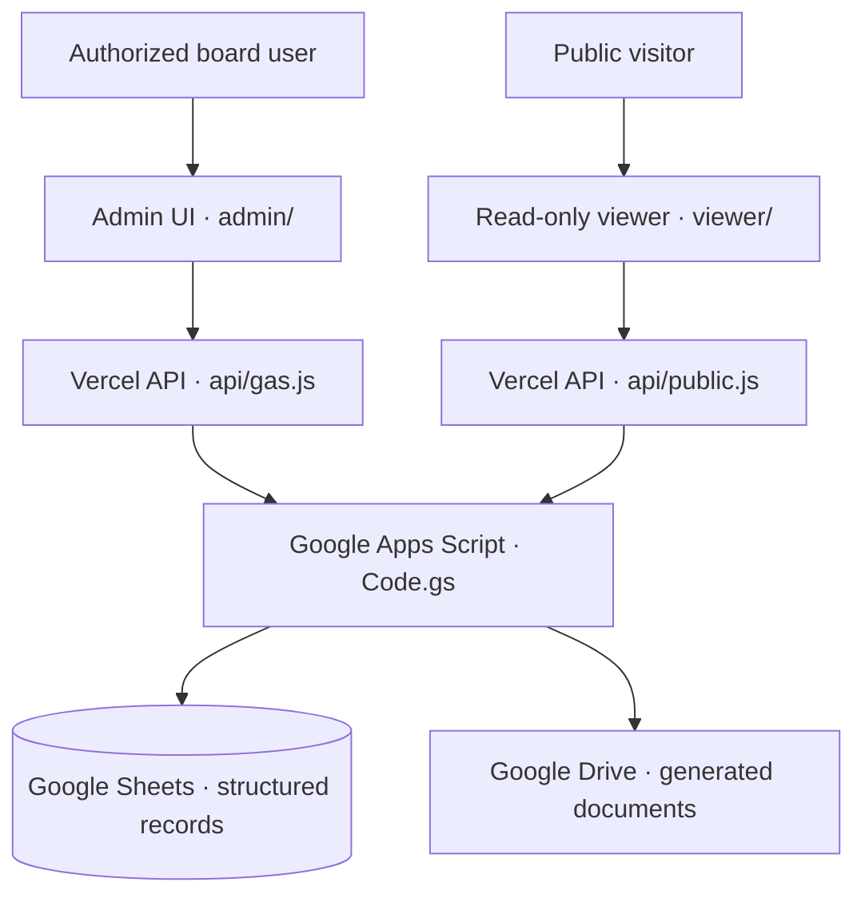

# Majelis Galilea

**A church board administration workspace built around meetings, records, finance, and correspondence.**

Majelis Galilea brings related administrative workflows into a web interface for the GMAHK Galilea congregation. Google Apps Script implements the application logic, Google Sheets stores structured operational records, and Vercel provides browser-facing pages and API proxies.

[Open the portal](https://majelis-galilea.vercel.app/) · [Contributor guide](.github/CONTRIBUTING.md) · [Board user guide](docs/panduan-pengurus.md)

[](https://github.com/zvenians/majelis-galilea/actions/workflows/ci.yml)

---

## Background

Board decisions produce information that must remain consistent across meetings, budget records, follow-up tasks, and official letters. When those records are maintained in disconnected spreadsheets and document files, it becomes difficult to trace a decision or confirm the next action.

This project provides a shared administrative interface while retaining the familiar Google Workspace tools used for storage and document production.

## Main modules

| Module | Scope |
| --- | --- |
| **Meeting governance** | Agendas, minutes, review states, decisions, action items, and meeting-oriented editing |
| **Treasury and budgeting** | Congregational funds, budget plans (RAPBJ), financial entries, and reconciliation summaries |
| **Secretariat** | Outgoing letters, tracking numbers, and document/PDF workflows |
| **People and responsibilities** | Member and family records, board roles, assignments, and relevant directories |
| **Inventory** | Congregation inventory and asset records |
| **Publication** | Public viewer data separated from authorized administration |

These are workflow categories in the codebase, not a promise that every feature is enabled for every deployed account. Permissions and content depend on the configured Apps Script environment.

## System architecture



### Boundaries

The interface is split between `admin/` and `viewer/`. The backend contains role checks and business rules; frontend visibility is not a substitute for server authorization. The public endpoint has a different access and caching model from administrative operations.

The code defines four primary role categories:

| Role | Intended area of responsibility |
| --- | --- |
| `ADMIN` | System setup, authorization, and oversight |
| `KEUANGAN` | Treasury and budget workflows |
| `PENGURUS` | Executive administration and correspondence |
| `MAJELIS` | Board-level access and approved meeting information |

Actual permissions are determined by the backend's access rules, not simply by the names above.

## Technology and storage

- **Frontend:** HTML, CSS, and JavaScript, with separate modules for core behavior, features, navigation, and presentation.
- **API:** Node.js handlers under `api/`, deployed through Vercel.
- **Business logic:** Google Apps Script V8 in `apps-script/Code.gs`.
- **Data:** Google Sheets, organized into operational worksheets; this is **not** a standalone SQL database.
- **Documents:** Google Workspace document workflows and Drive storage where configured.
- **Quality controls:** Node.js-based validation scripts and GitHub Actions.

## Code structure

```text
.
├── admin/
│   ├── index.html                 Authorized UI
│   ├── js/
│   │   ├── shell.js               Navigation and initialization
│   │   ├── core.js                Shared behavior
│   │   ├── features.js            Administrative modules
│   │   └── enhancements.js        Interaction improvements
│   └── styles/                    Base, features, visual refinement
├── viewer/
│   ├── index.html                 Public page
│   ├── app.js                     Public data loading and rendering
│   └── styles.css                 Visitor presentation
├── api/
│   ├── _gas.js                    Apps Script transport helpers
│   ├── gas.js                     Administrative API proxy
│   └── public.js                  Public data endpoint
├── apps-script/
│   ├── Code.gs                    Application logic
│   └── appsscript.json            Runtime manifest
├── scripts/                       Validators and workflow tests
├── docs/panduan-pengurus.md       Board documentation
├── .clasp.json.example            Apps Script configuration template
└── vercel.json                    Routing and asset cache policy
```

## Local development

This repository is not a conventional npm web application. There is no root `package.json`; the validation scripts run directly under Node.js.

**Prerequisites:** Node.js 24 (used by CI), an authorized Apps Script project for backend work, and the Vercel CLI only when testing serverless routes locally.

```bash
git clone https://github.com/zvenians/majelis-galilea.git
cd majelis-galilea
cp .clasp.json.example .clasp.json
node scripts/validate-gas.js
```

Fill the `scriptId` in your local `.clasp.json` only when connecting to an Apps Script project you are permitted to modify. The template itself does not provide credentials.

To preview the Vercel routes and static pages together:

```bash
npx vercel dev
```

Backend requests require a correctly configured Apps Script deployment; a local HTML preview alone cannot demonstrate live data persistence.

### Configuration

| Setting | Purpose | Where it belongs |
| --- | --- | --- |
| `APPS_SCRIPT_URL` | URL of the Apps Script web-app backend | Vercel environment |
| `.clasp.json` | Local `clasp` script-project association | Developer machine, not committed |
| Google Sheets and Drive IDs | Operational records and document storage | Authorized Apps Script setup |

Never add PINs, session material, account details, or secret values to the repository.

## Verification

The CI workflow runs the checks below:

```bash
node scripts/validate-gas.js
node scripts/test-governance.js
node scripts/test-simple-workflow.js
node scripts/test-access-boundaries.js
node scripts/test-frontend-structure.js
```

These checks cover syntax and manifest integrity, governance rules, a simplified meeting/budget workflow, access boundaries, and frontend/public-cache structure. They are source-level and simulated checks, **not** proof that every production workflow has been exercised with real church records.

Additional scripts such as `scripts/smoke-test.js` and `scripts/test-workspace-browser.js` exist for targeted testing; review their setup requirements before running them.

## Deployment responsibilities

The **frontend/API** and **Apps Script backend** have distinct release procedures.

1. Review a focused pull request and run the repository checks.
2. Verify `APPS_SCRIPT_URL` against the intended environment.
3. Review backend permission changes and sample the affected workflow using non-sensitive test records.
4. Publish a Vercel change only with deployment approval.
5. Update the Apps Script deployment separately where backend code changed; `clasp` operations are not implied by pushing to GitHub.

Do not publish production changes while inspecting or editing documentation.

## Administration and data safeguards

The platform handles potentially sensitive records, including members and financial information. Use accounts with the least access needed, keep test data synthetic, verify the backend's role checks, and limit sharing of exported documents.

When editing financial or governance features, validate both the write path and the subsequent read/reload. A success notification is not proof that the Google Sheet or Drive entry was updated.

## Related services

- [GMAHK Galilea congregation website](https://github.com/zvenians/gmahk-galilea)
- [GMAHK Galilea Digital Archive](https://github.com/zvenians/gmahk-galilea-digital-archive)
- [Board user guide](docs/panduan-pengurus.md)
- [Contribution and code review](.github/CONTRIBUTING.md)

---

**Built to support accountable congregation administration.** Maintained by [@zvenians](https://github.com/zvenians).
